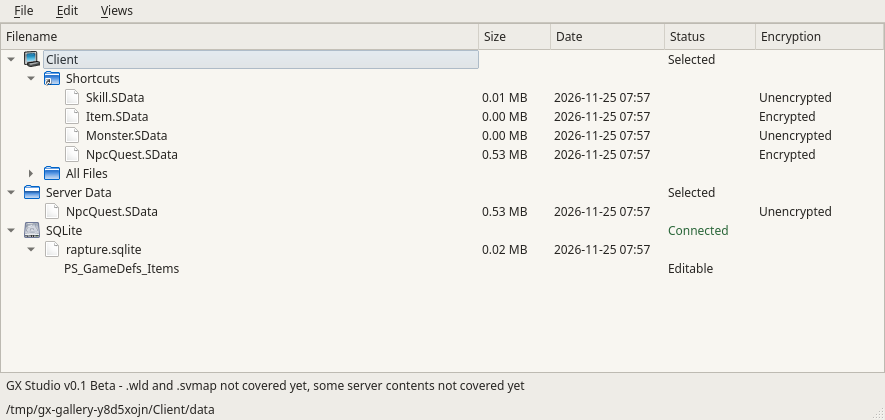

# GX Studio

**GX Studio v0.1 Beta** is the standalone desktop data editor for
[Shaiya GX](https://github.com/Spelunkern/Shaiya-GX). It opens loose EP5
client data, edits supported GX Server definitions in SQLite and synchronizes
NpcQuest rules with GX World. It also previews models, textures, effects and
audio in the workspace. The editor has its own build, issues and releases.

[Download the beta](https://github.com/Spelunkern/GX-Studio/releases) ·
[Gallery](gallery/README.md) · [Editing guide](docs/editing.md) ·
[Build and release guide](docs/building.md)

## Download and start

| Platform | Archive suffix | Launcher |
| --- | --- | --- |
| Windows x86-64 | `windows-x64.zip` | `GX Studio.exe` |
| Linux x86-64 | `linux-x64.tar.gz` | `GX Studio` |
| macOS Apple silicon | `macos-arm64.tar.gz` | `GX Studio.app` |
| macOS Intel | `macos-x64.tar.gz` | `GX Studio.app` |

1. Download the archive for your system from [Releases](https://github.com/Spelunkern/GX-Studio/releases).
2. Extract the entire folder to a writable location. Run the launcher inside
   the folder. Bundled Python and Qt run without a separate Python installation.
3. Open **File → Workspace Settings…** and choose the sources you want to use.

The Linux build targets Ubuntu 22.04 or equivalent system libraries on a newer
distribution. The macOS beta is ad hoc signed and ships without Apple
notarization. If Gatekeeper blocks the verified download, use **Open Anyway**
under **System Settings → Privacy & Security**. Each release publishes
`SHA256SUMS.txt` for download verification.

The package contains the editor and its dependencies. Point it at your own
Shaiya GX data and GX Server installation.

## Workspace

| Source | Choose | Purpose |
| --- | --- | --- |
| **Client Data** | Shaiya GX installation or its loose `data/` folder | Catalogs and assets for editing and previews |
| **Server Data** | GX Server installation or the data directory containing `game/` | GX World files such as `game/NpcQuest.SData` |
| **SQLite** | Automatic detection or a manual `rapture.sqlite` | Gameplay definitions and direct SQLite item edits |

SQLite looks for running GX World and GX Login processes. With a selected
server installation, it can also open that server’s `runtime/rapture.sqlite`
while GX is stopped. If detection finds several candidate databases, select
one explicitly. **Views → Detect GX Database** restores automatic detection.

Right-click **Client** to choose the client folder. **Shortcuts** groups
frequently used catalogs and **All Files** browses the loose data tree.
Double-click a supported file to open it. The **Encryption** column shows
the SData envelope the editor can identify.

`studio.ini` stores paths and interface settings alongside the launcher.
`backups/` holds dated copies created by saves and installs. Each portable
folder has its own settings and backups. Paths under the portable folder
move with it. External paths keep their absolute locations.

## What the beta covers

| Format or source | Editing and previews |
| --- | --- |
| `Item.SData` | Item families, grades, icon and enchant pickers, equipment models, lapis and quest links. SQLite item definitions through Save, Install or direct editing. |
| `Cash.SData` | Item Mall products, icon atlas, prices and 24 bundle slots. SQLite product synchronization. |
| `Skill.SData`, `NpcSkill.SData` | Player and Noss skills, NPC skills, named effects and rank-specific fields. Install uses the GX keys for each catalog. |
| `NpcQuest.SData` | Merchants, gatekeepers, standard NPCs, quests, dialogue and item links. Client and GX World files are handled separately. |
| `Monster.SData` and SQLite | Monster appearance, model preview, movement, attacks, resistances, experience, gold and drop grades. Separate client and SQLite saves. |
| `.MON`, `.ITM`, `.IT2`, `.MLT`, `.ALT` | Model tables, equipment, animation references and supported effect bindings. |
| Cloak `.PC` and `.CTL`, emblem `.DAT` | Cloak geometry and textures, emblem placement and texture catalogs. |
| Server `.svmap` | Client minimap and editing for ladders, NPC patrols, monster areas, portals, spawn boxes, and named areas. |
| Asset viewers | `.3DC`, `.3DO`, `.3DE`, `.ANI`, `.MANI`, `.VANI`, `.WTR`, `.SMOD`, `.DG`, `.EFT`, `.SEFF`, images, fonts and `.ogg`. |

**Beta limits.** Client world maps (`.wld`), several GX World catalogs
and the Pets, Wings and Costumes item categories remain outside editing
coverage. Some historical encrypted SData variants open read-only. The
viewer renders models and authored effects for inspection. See the
[editing guide](docs/editing.md) for field ownership, save behavior, recovery,
supported textures and preview limits.

## License

GX Studio source is available under the [BSD 3-Clause License](LICENSE).
[Third-party notices](NOTICE.md) cover format references, borrowed resources
and the libraries that ship in the portable packages.
