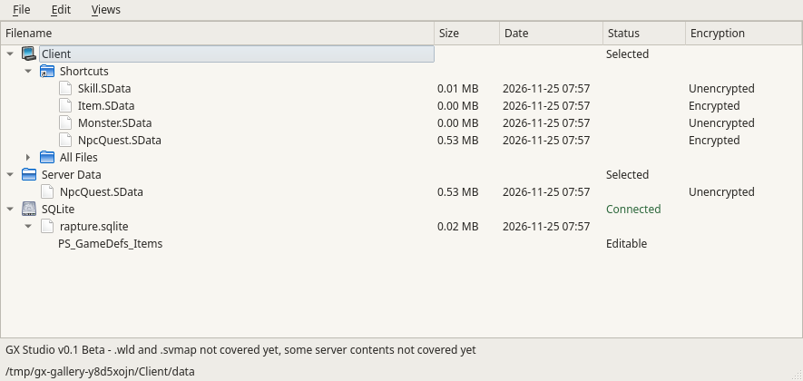
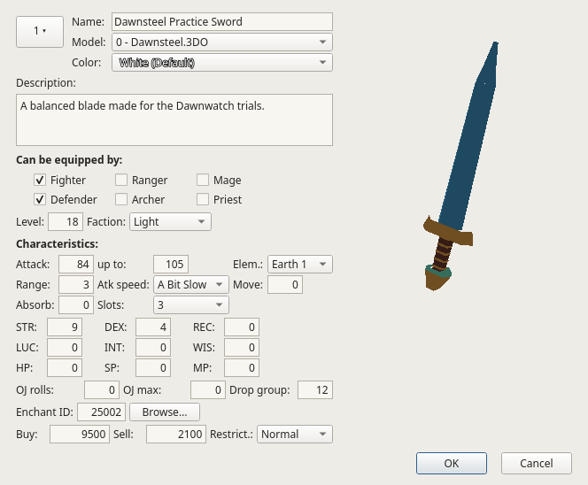
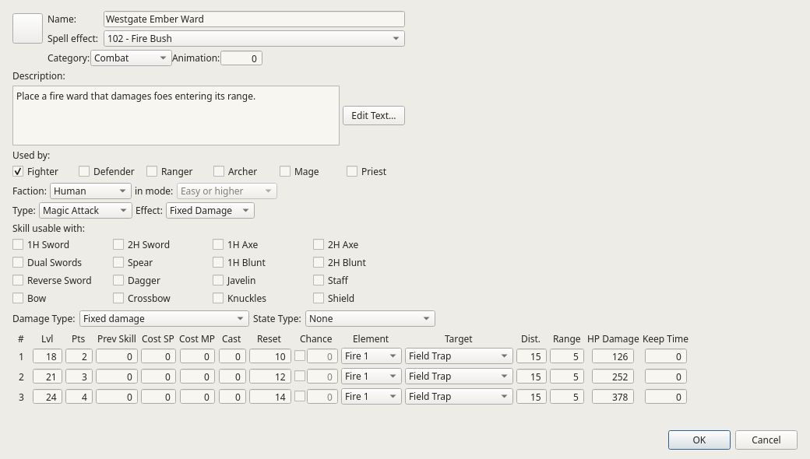
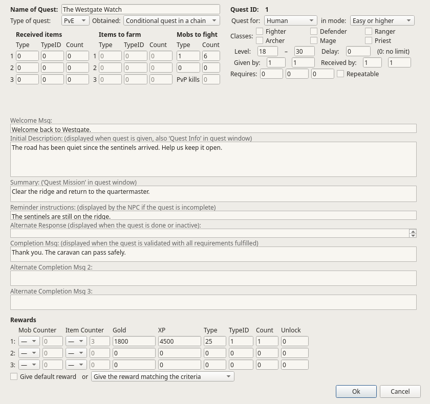
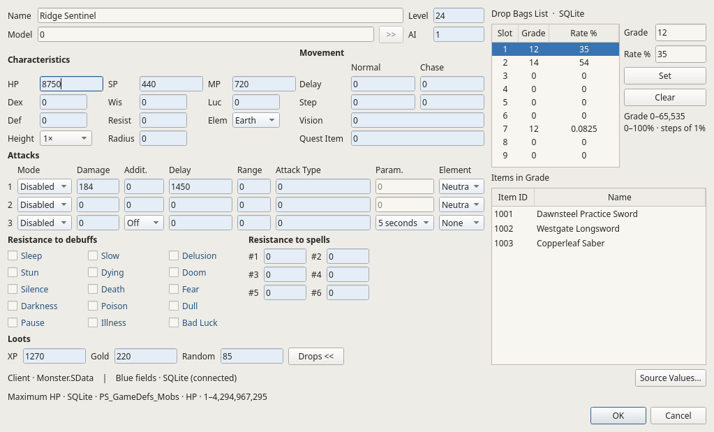
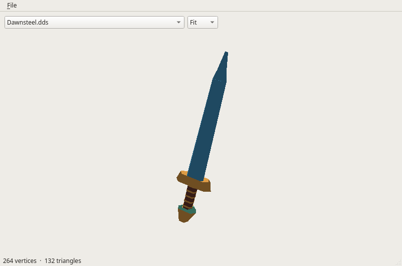

# GX Studio gallery

These screenshots show the beta with an invented workspace and sample
assets. Click an image to open it at full size.

## Workspace

Client shortcuts, file encryption, the supported GX World file and the
detected runtime SQLite database appear in a single window.

## Equipment

Edit a weapon's requirements, base damage, stats, sockets and enchanting
material. The viewer resolves the selected ITM record and its texture.

## Player skills

Browse player skills grouped by their native IDs and open the rank cells to
edit values. **Noss Skills** has its own tab.

## Quests

Quest Details includes requirements, objectives, texts and rewards. GX Studio
can write shared rules to the GX World copy while preserving server dialogue.

## Monster drops

Blue fields come from SQLite. The side panel pairs the drop grade and
chance with the corresponding items from the client catalog.

## Asset viewer

Inspect loose model files independently of the equipment record.

